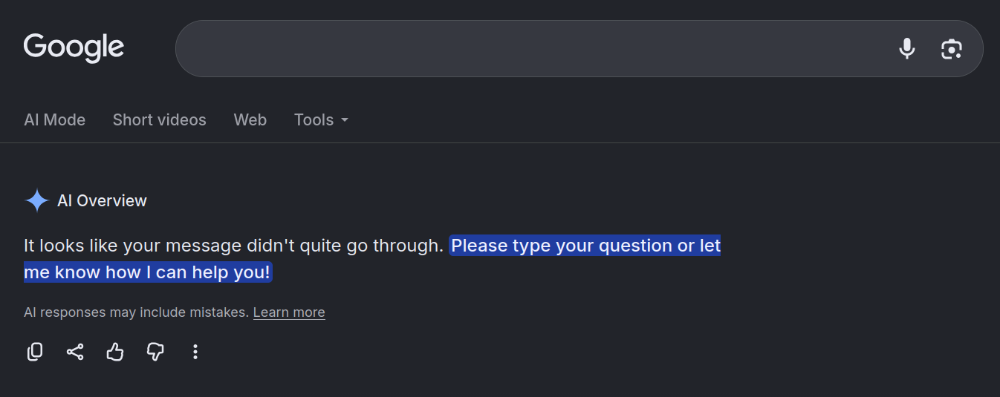
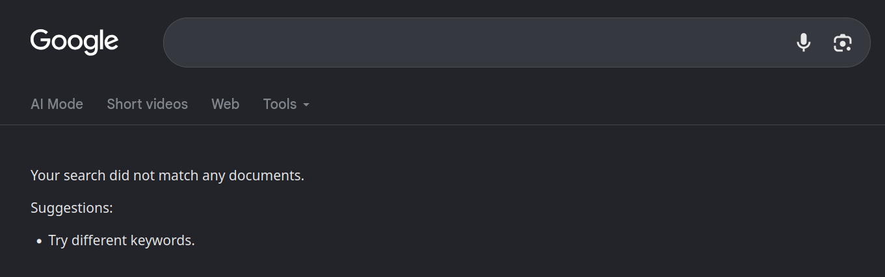

I was doing follow-up research for a [previous blog post about JSON-LD](/blog/json-ld-explained-for-personal-websites) when I made a typo whilst searching for a specific entity. As well as a normal search, Google also lets you search for entities by "Knowledge Graph Machine ID" - or `kgmid` for short. For example: the kgmid for Ethan Hawksley is [/g/11m62cgdtf](https://www.google.com/search?kgmid=/g/11m62cgdtf), and the kgmid for a cheese sandwich is [/m/0520n6f](https://www.google.com/search?kgmid=/m/0520n6f).

In my search, the kgmid was invalid and didn't correlate to any specific entity. However, instead of a "No results found" page, I was served an AI Overview explaining the answer to a maths homework problem.

Amused, I refreshed the page and was met with commentary about "Mid-Century Modern" design. Another refresh provided a breakdown of UK pension law. It seemed like the state from one search was bleeding through into my own search, so I collected the following details and reported them to Google's security team.

## Why it happened

<BlogVideo
  src="./google-search-state-bleed.mp4"
  caption="Here's the proof-of-concept video I recorded. Each time I reload the page, I'm served a new AI Overview."
/>

Whenever I supplied an invalid kgmid without an accompanying query, it would trigger the state bleed and provide a random AI Overview. However, when I supplied a query parameter, it would override the kgmid and ordinary results would load for the query.

Also note that after each refresh, it took a few seconds for the AI Overview to generate. This makes it seem more likely that the query itself was bleeding across requests, rather than the AI's response. Analysis of the network logs showed an internal routing token (`mlro`) being minted upon initial page load, which was passed to the AI Overview endpoint to fetch the generated answer shortly afterwards.

My guess for why these routing tokens were minted would be that the search context was recycled between requests, which was then used to generate an AI Overview. Even if the underlying mechanism was a [cache leak](https://portswigger.net/web-security/web-cache-poisoning), a [hash collision](https://en.wikipedia.org/wiki/Hash_collision), or something similar, the end result stays the same. Unmapped kgmids caused state to bleed from one search to another.

## Remediation

Google's remediation rolled out in two separate phases. The first phase caused AI Overviews to always treat invalid kgmids as an empty query, leading the model to ask for clarification.

The second phase resolved the underlying issue entirely: AI Overviews no longer generate when an invalid kgmid is supplied.

Google Search was built with the assumption that every search has a corresponding query. Breaking that assumption caused the engine to [fail open](https://en.wikipedia.org/wiki/Fail-safe#Fail_safe_and_fail_secure), and all it took was a small typo whilst researching a blog post.
